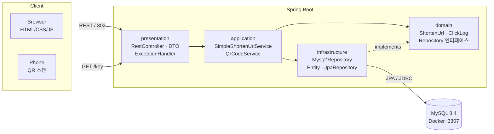
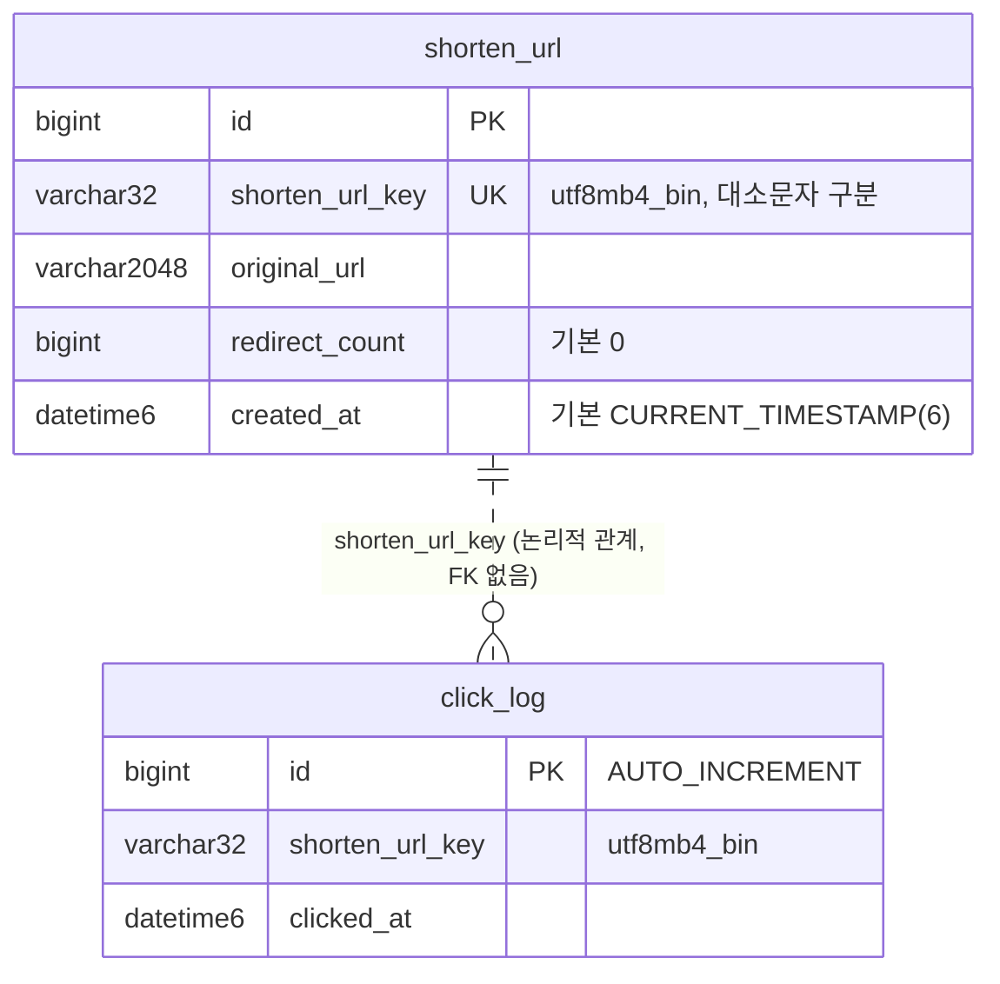

# ShortLab: 단축 URL 서비스

긴 URL을 짧은 링크로 바꿔 주고, 단축 링크로 접속하면 원본 URL로 이동(302)시키면서 **접속 횟수와 접속 기록**을 남기는 Spring Boot 서버입니다.
Map 저장으로 시작해 Docker MySQL 연동으로 확장했고, **별칭 · QR 코드 · 클릭 로그(기간 조회, 더 보기)** 를 직접 기획해 추가했습니다.

## 목차

1. [기술 스택](#1-기술-스택)
2. [주요 기능과 동작 흐름](#2-주요-기능과-동작-흐름)
3. [시스템 아키텍처](#3-시스템-아키텍처)
4. [백엔드 패키지 구조](#4-백엔드-패키지-구조)
5. [데이터베이스 설계](#5-데이터베이스-설계)
6. [API 명세](#6-api-명세)
7. [주요 설계 사항](#7-주요-설계-사항)
8. [실행 방법](#8-실행-방법)
9. [테스트](#9-테스트)
10. [개선 및 확장 계획](#10-개선-및-확장-계획)
11. [프로젝트를 통해 학습한 내용](#11-프로젝트를-통해-학습한-내용)

---

## 1. 기술 스택


| 구분 | 기술 | 용도 |
|---|---|---|
| 언어 |  | |
| 프레임워크 |  | REST API, 302 리다이렉트 (`spring-boot-starter-webmvc`) |
| 데이터 접근 |   | 엔티티 매핑, 쿼리 메서드, `@Query` |
| 데이터베이스 |   | 링크·클릭 로그 영속화 (Docker 컨테이너) |
| 입력 검증 |  | `@Valid`, `@URL`, `@Pattern`으로 요청 DTO 검증 |
| QR 코드 |  | 서버에서 SVG 생성 |
| 프론트엔드 |    | `src/main/resources/static/`, 외부 라이브러리·CDN 없음 |
| 빌드 | -02303A?logo=gradle&logoColor=white) | |
| 테스트 |   | `@WebMvcTest`, `@SpringBootTest` |

---

## 2. 주요 기능과 동작 흐름

### 2-1. 단축 URL 생성 (랜덤 키 / 별칭)

- 원본 URL을 받아 단축 키를 만들어 저장합니다.
- `alias`를 보내면 그 값이 단축 키가 되고, 비우면 **base56 8자리 랜덤 키**를 씁니다. 헷갈리는 문자(`0, 1, I, O, l, o`)는 제외했습니다.
- 랜덤 키가 이미 있으면 최대 5번 다시 만들고, 그래도 실패하면 500을 반환합니다.
- 별칭은 영문·숫자·하이픈 3~20자이며, 이미 있거나 예약어(`shortenUrl`, `assets`, `error`, `index`, `favicon`)면 409입니다.

```
Client                Controller            Service                    Repository / DB
  │ POST /shortenUrl     │                     │                              │
  │ {originalUrl, alias} │                     │                              │
  ├─────────────────────▶│ @Valid 검증(400)     │                              │
  │                      ├────────────────────▶│ alias 있음?                   │
  │                      │                     │  ├ 예: 예약어·중복 확인 ─────▶│ existsByShortenUrlKey
  │                      │                     │  └ 아니오: 랜덤 키 생성(≤5회)▶│ findShortenUrlByShortenUrlKey
  │                      │                     ├─ saveShortenUrl ─────────────▶│ INSERT shorten_url
  │                      │                     │  (unique 위반 → 409)          │
  │◀─────────────────────┴─────────────────────┤ {originalUrl, shortenUrlKey}  │
```

### 2-2. 리다이렉트와 접속 횟수 증가

- `GET /{key}`로 접속하면 원본 URL로 `302 Found` + `Location` 헤더를 응답합니다.
- 301은 브라우저가 캐시해서 서버를 거치지 않기 때문에 접속 횟수를 셀 수 없어 쓰지 않았습니다.
- 접속 횟수는 `redirect_count = redirect_count + 1` 한 문장으로 **DB에서 원자적으로** 증가시킵니다.

```
Browser            Controller              Service                     DB
  │ GET /aB3dE5gH     │                       │                          │
  ├──────────────────▶├──────────────────────▶│ ① 조회 ────────────────▶│ SELECT shorten_url
  │                   │                       │   없으면 404             │
  │                   │                       │ ② 횟수 증가 ───────────▶│ UPDATE redirect_count+1   (트랜잭션 A)
  │                   │                       │ ③ 클릭 로그 저장 ──────▶│ INSERT click_log          (트랜잭션 B, REQUIRES_NEW)
  │                   │                       │   실패해도 예외를 삼킴    │
  │◀──────────────────┤ 302 Location: 원본 URL │                          │
```

### 2-3. 클릭 로그 조회 (기간 필터 + 더 보기)

- 접속할 때마다 (단축 키, 접속 시각 `Asia/Seoul`)을 한 줄씩 기록합니다.
- `from`, `to`(날짜)로 기간을 좁히고, `beforeId`로 **커서 기반 "더 보기"** 를 합니다. 종료일은 하루 전체가 포함되도록 `to + 1일 00:00` 미만으로 처리합니다.
- `limit + 1`건을 조회해 `hasNext`를 계산하므로 `count` 쿼리가 필요 없습니다. 한 번에 최대 50건입니다.

```
GET /shortenUrl/aB3dE5gH/clicks?from=2026-11-01&to=2026-11-25&size=20
 → { "clicks": [ {"id": 42, "clickedAt": "2026-11-25T16:57:01"}, ... ], "hasNext": true }

GET /shortenUrl/aB3dE5gH/clicks?beforeId=23&size=20      ← 마지막으로 받은 id보다 오래된 기록
```

### 2-4. QR 코드

- `GET /shortenUrl/{key}/qr`가 단축 링크를 담은 QR을 **SVG**로 응답합니다. 확대해도 깨지지 않습니다.
- QR에는 원본 URL이 아니라 **단축 링크**가 담깁니다. 스캔해도 서버를 거치므로 접속 기록이 남습니다.
- 단축 링크의 호스트는 요청이 들어온 호스트(`ServletUriComponentsBuilder`)로 만듭니다. 휴대폰으로 확인하려면 `localhost`가 아니라 PC의 IP로 접속해 링크를 만들어야 합니다.

### 2-5. 통계 조회와 화면

- `GET /shortenUrl/{key}`로 원본 URL과 접속 횟수를 조회합니다.
- 화면은 링크 만들기(별칭 입력), 결과 카드(단축 URL, QR 저장), 통계 조회(접속 횟수, 기간 필터가 있는 접속 기록, 더 보기), 최근 만든 링크 목록으로 이루어져 있고 **5초마다 자동 갱신**합니다. 최근 링크 목록은 브라우저 `localStorage`에 저장합니다.

> 화면 스크린샷은 `docs/images/`에 추가해 넣을 수 있습니다.

---

## 3. 시스템 아키텍처



요청 흐름은 `Controller → Service → Repository(interface) → MysqlRepository → JPA → MySQL`입니다. 서비스는 도메인에 정의된 `ShortenUrlRepository`, `ClickLogRepository` 인터페이스에 의존하고, 실제 구현체(`Mysql*Repository`)는 infrastructure 계층이 제공합니다.

---

## 4. 백엔드 패키지 구조

```
src/main/java/com/example/shortlab
├── ShortlabApplication.java
├── presentation                         # HTTP 입·출력
│   ├── ShortenUrlRestController.java    #   생성 / 리다이렉트(302) / 통계 / 클릭 로그 / QR
│   ├── GlobalExceptionHandler.java      #   도메인 예외 → 404, 409, 500
│   └── dto
│       ├── ShortenUrlCreateRequestDto   #   @NotBlank @URL @Pattern(alias)
│       ├── ShortenUrlCreateResponseDto
│       ├── ShortenUrlInformationDto
│       └── ClickLogPageResponseDto      #   { clicks[], hasNext }
├── application                          # 유스케이스 조율, 트랜잭션 경계
│   ├── SimpleShortenUrlService.java
│   └── QrCodeService.java               #   ZXing → SVG
├── domain                               # 규칙과 저장소 약속 (프레임워크 비의존)
│   ├── ShortenUrl.java                  #   base56 키 생성, 접속 횟수
│   ├── ClickLog.java                    #   record(id, clickedAt)
│   ├── ShortenUrlRepository.java        #   interface
│   ├── ClickLogRepository.java          #   interface
│   └── exception                        #   NotFound / Duplicate / LackOfKey / InvalidOriginalUrl
└── infrastructure                       # DB 구현
    ├── MysqlShortenUrlRepository.java   #   Entity ↔ 도메인 변환
    ├── MapShortenUrlRepository.java     #   1단계 인메모리 구현 (비교용, 빈 등록 안 함)
    ├── ShortenUrlEntity.java
    ├── ShortenUrlJpaRepository.java     #   쿼리 메서드 + @Modifying @Query
    └── clicklog
        ├── MysqlClickLogRepository.java #   save: REQUIRES_NEW
        ├── ClickLogEntity.java
        └── ClickLogJpaRepository.java   #   기간·커서 조회 JPQL

src/main/resources/static                # index.html, assets/(style.css, app.js)
src/test/java/com/example/shortlab       # 서비스·컨트롤러·도메인·트랜잭션 테스트
```

---

## 5. 데이터베이스 설계

### ERD



### DDL

```sql
CREATE TABLE shorten_url (
  id              BIGINT        NOT NULL AUTO_INCREMENT,
  shorten_url_key VARCHAR(32)   CHARACTER SET utf8mb4 COLLATE utf8mb4_bin NOT NULL,
  original_url    VARCHAR(2048) NOT NULL,
  redirect_count  BIGINT        NOT NULL DEFAULT 0,
  created_at      DATETIME(6)   NOT NULL DEFAULT CURRENT_TIMESTAMP(6),
  PRIMARY KEY (id),
  UNIQUE KEY uk_shorten_url_key (shorten_url_key)
) ENGINE=InnoDB DEFAULT CHARSET=utf8mb4;

CREATE TABLE click_log (
  id              BIGINT      NOT NULL AUTO_INCREMENT,
  shorten_url_key VARCHAR(32) CHARACTER SET utf8mb4 COLLATE utf8mb4_bin NOT NULL,
  clicked_at      DATETIME(6) NOT NULL,
  PRIMARY KEY (id),
  KEY idx_click_log_key_time (shorten_url_key, clicked_at)
) ENGINE=InnoDB DEFAULT CHARSET=utf8mb4;
```

### 설계 포인트

- **`shorten_url_key` UNIQUE + `utf8mb4_bin`:** `aB3`과 `ab3`을 다른 키로 취급하고, 중복 생성의 최종 방어선을 DB 제약으로 둡니다.
- **`click_log`에 FK를 두지 않음:** 접속마다 INSERT가 일어나는 테이블이라 FK 검사 비용을 피하고, 로그 저장이 링크 테이블과 독립적으로 동작하게 했습니다. 대신 정합성은 서비스에서 확인합니다(조회 시 키 존재 여부 → 404).
- **`(shorten_url_key, clicked_at)` 인덱스:** 링크별·기간별 조회용입니다. 현재 쿼리는 `id desc` 커서 정렬을 쓰므로 실행 계획 확인이 필요합니다(개선 계획 참고).
- **`ddl-auto=validate`:** 테이블은 직접 SQL로 만들고, 엔티티와 테이블·컬럼·타입이 어긋나면 앱 시작 때 실패하게 했습니다. 길이·unique 제약·인덱스 불일치는 보통 잡지 못하므로 엔티티의 `length`는 DDL에 맞춰 직접 관리합니다(`shorten_url_key`는 32).

---

## 6. API 명세

| 메서드 | 경로 | 설명 | 성공 | 오류 |
|---|---|---|---|---|
| POST | `/shortenUrl` | 단축 URL 생성. 본문 `{"originalUrl":"https://...","alias":"my-menu"}` (`alias` 선택) | 200 | 400(URL·별칭 형식), 409(별칭 중복·예약어), 500(키 생성 실패) |
| GET | `/{key}` | 원본 URL로 302 이동, 접속 횟수 증가, 클릭 로그 기록 | 302 | 404 |
| GET | `/shortenUrl/{key}` | 원본 URL, 접속 횟수 조회 | 200 | 404 |
| GET | `/shortenUrl/{key}/clicks` | 접속 기록 조회. `from`, `to`(yyyy-MM-dd), `beforeId`, `size`(기본 20, 최대 50) | 200 | 400(`from` > `to`), 404 |
| GET | `/shortenUrl/{key}/qr` | 단축 링크의 QR 코드 (`image/svg+xml`) | 200 | 404 |

경로 변수 정규식 `/{key:[A-Za-z0-9-]+}`에 점(`.`)이 없어서 `index.html` 같은 정적 파일은 단축 키로 잡히지 않습니다.

| 코드 | 의미 | 예 |
|---|---|---|
| 400 | 요청 값이 잘못됨 | URL이 `http(s)`가 아님, 별칭 형식 위반, 기간 역전 |
| 404 | 대상이 없음 | 존재하지 않는 단축 키 |
| 409 | 현재 상태와 충돌 | 이미 사용 중인 별칭, 예약어, 동시 생성 충돌 |
| 500 | 서버가 처리할 수 없음 | 랜덤 키를 5번 만들어도 모두 충돌 |

---

## 7. 주요 설계 사항

### ① 저장소를 인터페이스로 분리 (Map → MySQL 교체)
`ShortenUrlRepository`를 domain에 두고, 1단계의 `MapShortenUrlRepository`를 2단계에서 `MysqlShortenUrlRepository`로 교체했습니다. 서비스 코드는 바뀌지 않았습니다. 도메인 객체(`ShortenUrl`)와 DB 객체(`ShortenUrlEntity`)를 분리하고, 변환은 `MysqlShortenUrlRepository`가 맡습니다.

### ② 접속 횟수는 DB에서 원자적으로 증가
"읽고 → 더하고 → 저장"하면 동시 접속에서 횟수가 유실됩니다. 그래서 `@Modifying @Query("update ... set redirectCount = redirectCount + 1 where shortenUrlKey = :key")`로 DB가 한 문장으로 처리하게 했습니다. (인메모리 구현체는 `AtomicLong`을 사용하며, 동시 증가 테스트가 있습니다.)

### ③ 리다이렉트에 `@Transactional`을 걸지 않고, 클릭 로그는 `REQUIRES_NEW`
`getOriginalUrlByShortenUrlKey`는 의도적으로 트랜잭션을 걸지 않습니다. 조회, 횟수 증가, 로그 저장을 각각 짧은 트랜잭션으로 나누면
- 로그 저장이 실패해도(예외를 삼킴) **횟수 증가가 롤백되지 않고**,
- 인기 URL의 행 락을 오래 잡지 않고,
- 한 요청이 DB 커넥션을 둘씩 쓰지 않습니다.

`MysqlClickLogRepository.save`는 `Propagation.REQUIRES_NEW`라서, 나중에 바깥에 트랜잭션이 생겨도 로그 저장이 독립적으로 커밋·실패합니다. `@Transactional`은 프록시를 거쳐야 적용되므로 같은 클래스 내부 호출이 아니라 서비스 → 저장소 빈 호출 구조로 두었고, 이 동작을 `ClickLogTransactionTest`로 검증합니다.

### ④ 중복 방지는 check-then-insert + DB unique 제약
별칭·키 중복은 먼저 `exists`/`find`로 확인하지만, 확인과 저장 사이에 다른 요청이 끼어들 수 있습니다. 그래서 `DataIntegrityViolationException`을 잡아 409로 바꾸고, **unique 제약을 최종 방어선**으로 삼았습니다.

### ⑤ 커서 기반 페이지네이션
접속 기록은 계속 쌓이므로 `offset` 방식은 새 기록이 들어오면 페이지가 밀립니다. `id < beforeId order by id desc limit n+1`로 이어서 읽고 `hasNext`를 계산해 `count` 쿼리와 페이지 밀림을 모두 피했습니다. 선택 조건은 `(:from is null or ...)` 형태로 JPQL 한 개에서 처리합니다.

### ⑥ 예외는 도메인 언어로, HTTP 변환은 한 곳에서
도메인 예외(`NotFound...`, `Duplicate...`, `LackOfShortenUrlKey...`)는 HTTP를 모릅니다. `GlobalExceptionHandler`(`@RestControllerAdvice`)가 404, 409, 500으로 변환합니다.

DB 예외 변환 규칙은 다음과 같습니다.
- **DB 예외 → 도메인 예외 변환은 서비스에서** 합니다.
- 도메인 의미가 있는 것(키 중복)만 변환합니다. 길이·필수값은 저장 전에 보장하므로, 저장 시의 `DataIntegrityViolationException`은 unique 키 충돌로 봅니다.
- 나머지 `DataAccessException`은 그대로 올려 500으로 처리합니다. 단, 클릭 로그 저장 실패는 리다이렉트를 막지 않도록 서비스에서 삼킵니다.

### ⑦ QR은 단축 링크를 담은 SVG
원본 URL을 직접 담으면 QR 스캔은 서버를 거치지 않아 접속 기록이 남지 않습니다. 단축 링크를 담아 모든 접속이 같은 경로로 집계되게 했습니다. SVG는 모듈 전체를 하나의 `<path>`로 그려 점 사이에 앤티앨리어싱 틈이 생기지 않게 했습니다.

---

## 8. 실행 방법

### 1) MySQL 컨테이너

```bash
docker run --name shortlab-mysql \
  -e MYSQL_ROOT_PASSWORD=<비밀번호> \
  -p 3307:3306 \
  -v shortlab-mysql-data:/var/lib/mysql \
  -d mysql:8.4

docker exec -it shortlab-mysql mysql -uroot -p -e "CREATE DATABASE shortlab CHARACTER SET utf8mb4;"
```

호스트 포트는 3307입니다. (3306이 이미 사용 중인 환경을 가정)

### 2) 스키마

[5. 데이터베이스 설계](#5-데이터베이스-설계)의 DDL을 `shortlab` 데이터베이스에 실행합니다. 앱은 `ddl-auto=validate`라서 **앱을 켜기 전에** 테이블이 있어야 합니다.

### 3) 설정 확인 (`src/main/resources/application.properties`)

```properties
spring.datasource.url=jdbc:mysql://localhost:3307/shortlab
spring.datasource.username=root
spring.datasource.password=<비밀번호>
spring.jpa.hibernate.ddl-auto=validate
spring.jpa.open-in-view=false
```

### 4) 실행

```bash
./gradlew bootRun
```

브라우저에서 `http://localhost:8080`을 엽니다. 8080 포트가 이미 사용 중이면 `server.port`를 바꾸세요.

### 5) 동작 확인 예시

```bash
# 생성 (랜덤 키)
curl -X POST localhost:8080/shortenUrl -H 'Content-Type: application/json' \
  -d '{"originalUrl":"https://example.com"}'

# 생성 (별칭)
curl -X POST localhost:8080/shortenUrl -H 'Content-Type: application/json' \
  -d '{"originalUrl":"https://example.com","alias":"my-menu"}'

curl -i localhost:8080/my-menu                       # 302 + Location
curl localhost:8080/shortenUrl/my-menu               # 접속 횟수
curl "localhost:8080/shortenUrl/my-menu/clicks?size=5"
curl localhost:8080/shortenUrl/my-menu/qr            # SVG
```

---

## 9. 테스트

```bash
./gradlew test      # MySQL 컨테이너가 켜져 있어야 함 (통합 테스트 포함)
```

| 테스트 | 검증 내용 |
|---|---|
| `ShortenUrlTest` | 여러 스레드가 동시에 접속 횟수를 올려도 값이 유실되지 않는다 |
| `SimpleShortenUrlServiceTest` | 키가 계속 충돌하면 `LackOfShortenUrlKeyException`, 한 번 충돌하면 재시도 후 저장 (Mockito) |
| `SimpleShortenUrlServiceTest2` | 생성 후 조회하면 원본 URL이 나오고, 없는 키는 예외 |
| `ShortenUrlRestControllerTest` | 단축 키 접속 시 302 + `Location`, 없는 키는 404 (`@WebMvcTest`) |
| `ClickLogTransactionTest` | 바깥 트랜잭션에서 로그 저장이 실패해도 카운트 증가가 유지되고, 바깥이 롤백돼도 저장한 로그는 독립적으로 남는다 (`REQUIRES_NEW`) |
| `ShortlabApplicationTests` | 컨텍스트 로딩 |

수동 QA는 생성·잘못된 URL(400)·리다이렉트(302)·접속 횟수·없는 키(404)·서버 재시작 후 데이터 유지·별칭 중복/예약어(409)·별칭 형식(400)·클릭 로그·QR 스캔을 확인했습니다.

---

## 10. 개선 및 확장 계획

| 우선순위 | 항목 | 내용 |
|---|---|---|
| 높음 | **링크 만료일** | 생성 시 만료 시각을 받고, 만료된 링크는 원본으로 보내지 않기(410 또는 404). `shorten_url.expires_at` 컬럼 추가 |
| 높음 | **DDL 관리** | 지금은 SQL을 직접 실행합니다. Flyway를 도입해 스키마를 버전 관리하고, 비밀번호를 환경 변수·프로필로 분리 |
| 높음 | **계층 의존 정리** | `SimpleShortenUrlService`가 `infrastructure`의 `ClickLogEntity`, `ClickLogJpaRepository`를 import하고 있어(현재 미사용) `application → domain`만 보는 구조에 어긋납니다. 제거 필요 |
| 높음 | **키 길이 정합성** | `ClickLogEntity.shortenUrlKey`는 `length = 16`인데 별칭은 최대 20자, DB 컬럼은 32입니다. 엔티티 길이를 맞춤 |
| 중간 | **클릭 로그 비동기 저장** | 리다이렉트 응답 안에서 동기로 저장 중입니다. 트래픽이 늘면 큐(이벤트 + `@Async` 또는 메시지 큐)로 분리하고, 저장 실패는 삼키지 말고 로깅 |
| 중간 | **조회 성능** | `order by id desc`와 `(key, clicked_at)` 인덱스가 맞는지 `EXPLAIN`으로 확인하고, 필요하면 `(key, id)` 인덱스로 교체. 많아진 로그는 집계 테이블로 요약 |
| 중간 | **조회수 캐싱** | 인기 링크는 Redis 캐시(키 → 원본 URL)와 카운터 배치 반영으로 DB 부하 감소 |
| 중간 | **랜덤 키 충돌 처리** | 조회 후 저장(check-then-insert)을 줄이고, 저장을 시도한 뒤 unique 위반이면 재생성하는 방식으로 단순화. `Random` → `SecureRandom` 검토 |
| 중간 | **입력 검증 보강** | `new URI()` 검증은 랜덤 키 경로에만 적용됩니다. 검증 위치를 한 곳으로 통일하고 `GlobalExceptionHandler`에 400 처리(`InvalidOriginalUrlException`, 검증 실패) 추가 |
| 낮음 | **사용자·권한** | 로그인, 내 링크 목록, 통계 접근 제한 (현재는 키만 알면 누구나 조회) |
| 낮음 | **통계 확장** | 일별·시간대별 접속 추이 차트, 유입 경로(Referer), 기기 구분 |
| 낮음 | **QR 옵션** | 크기·색상 선택, PNG 서버 생성 |
| 낮음 | **운영** | Docker Compose로 앱 + MySQL 한 번에 실행, CI(GitHub Actions)에서 테스트 자동 실행 |

---

## 11. 프로젝트를 통해 학습한 내용

- **계층형 구조와 의존 방향:** 서비스가 인터페이스에만 의존하게 하면 저장소 구현을 Map에서 MySQL로 바꿔도 비즈니스 코드를 건드리지 않아도 됩니다. 반대로 서비스가 구현체를 import하면 이 이점이 사라진다는 것도 코드 리뷰를 하며 확인했습니다.
- **Spring Data JPA의 동작 방식:** 인터페이스에 메서드 이름(`findByShortenUrlKey`, `existsBy...`)만 적으면 구현이 자동 생성되고, 이름으로 표현할 수 없는 쿼리는 `@Query`로 직접 적습니다. `@Modifying`은 데이터를 바꾸는 쿼리이며 트랜잭션이 필요합니다.
- **동시성 문제와 해결 위치:** 애플리케이션에서 "읽고 더하고 저장"하면 값이 유실됩니다. `AtomicLong`은 한 JVM 안에서만 안전하고, 여러 서버·DB가 얽히면 **DB의 원자적 UPDATE**와 **unique 제약**이 최종 방어선이 됩니다.
- **트랜잭션 경계와 전파:** `@Transactional`은 프록시로 동작하므로 같은 클래스 내부 호출에는 적용되지 않습니다. 트랜잭션을 길게 잡으면 락 점유가 길어지고, `REQUIRES_NEW`로 부가 작업(로그)의 실패를 핵심 작업(카운트)과 격리할 수 있습니다. 이를 코드와 테스트로 직접 검증했습니다.
- **HTTP 상태 코드의 의미:** 301(영구 이동, 브라우저 캐시)과 302(임시 이동)의 차이가 "접속 횟수를 셀 수 있는가"를 결정했고, 400/404/409/500을 상황별로 구분해 API를 설계했습니다.
- **페이지네이션 설계:** offset 방식은 데이터가 계속 쌓이면 페이지가 밀립니다. 커서(`beforeId`)와 `limit + 1` 조회로 `count` 없이 "더 보기"를 구현했습니다.
- **DB 설계 감각:** 대소문자 구분 콜레이션(`utf8mb4_bin`), unique 인덱스, 복합 인덱스, FK를 두지 않는 선택의 장단점, `ddl-auto=validate`로 스키마 불일치를 시작 시점에 잡는 방법을 익혔습니다.
- **테스트 전략:** 순수 단위 테스트(Mockito), 웹 계층 슬라이스 테스트(`@WebMvcTest`), 실제 DB를 쓰는 통합 테스트를 목적에 맞게 나눠 썼고, 동시성과 트랜잭션처럼 눈으로 확인하기 어려운 동작을 테스트로 고정했습니다.
- **서비스 관점의 판단:** 로그 저장 실패가 사용자 경험(리다이렉트)을 막으면 안 된다는 우선순위 판단, QR에 어떤 URL을 담을지에 따라 통계가 달라진다는 점처럼 기능의 목적에서 설계가 갈린다는 것을 배웠습니다.
